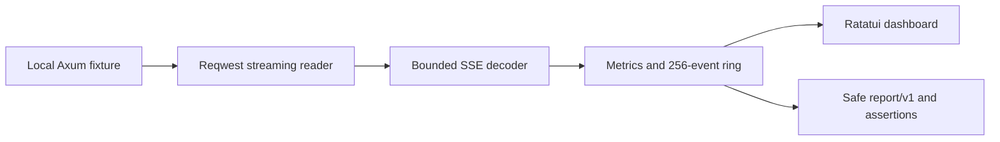

# StreamScope

A local-first Rust tool for developers inspecting **Server-Sent Events (SSE)**: see framing errors, client-observed event gaps, and a live terminal timeline. No accounts, model provider, API keys, telemetry, or database.

**Status:** prototype, proposed 0.1.0. Not published to crates.io. Linux and macOS CI checks pass; no release is published yet. Repository: https://github.com/Olmer1st/StreamScope.

## Try it in 60 seconds

Install Rust 1.90.0 with rustup, then from the checkout:

```sh
cargo build --locked --workspace
cargo run --locked -p streamscope-cli -- demo --scenario normal
```

In another terminal:

```sh
cargo run --locked -p streamscope-cli -- watch --url http://127.0.0.1:8383/events
```

Use **j/k or arrows** to select an event, **space** to freeze the view, **q** to quit. Capture continues while frozen. Only 256 previews are retained; eviction is shown. Ctrl-C restores the terminal and cancels capture.

For headless checks:

```sh
cargo run --locked -p streamscope-cli -- check --url http://127.0.0.1:8383/events --max-gap-ms 1500 --first-event-ms 2000 --require-last-event done --format json
```

Normal emits four events and passes. Stop the demo with Ctrl-C, restart with `--scenario gap`, then repeat the check: event 3 follows an approximately 4100ms pause, producing `GAP_EXCEEDED` and exit 2. This is a **client observation**, not proof of server or model execution time. Other scenarios: `burst`, `truncated`, `bad-utf8`.

[Actual terminal recording](docs/demo.cast) and [captured fixture results](docs/demo-results.json) are generated from the program, not mockups. Play the cast with `asciinema play docs/demo.cast` if asciinema is installed.

## Install for local use

```sh
cargo install --locked --path crates/streamscope-cli
streamscope --help
```

Path dependencies require the workspace checkout. Registry publication is disabled until release preparation is complete.

## Releases

Version tags trigger checked Linux/macOS binary releases through GitHub Actions. See the [release process](docs/releases.md) for version preparation, assets, and limitations. Ordinary commits run checks without publishing.

## Test

```sh
cargo fmt --all -- --check
cargo clippy --locked --workspace --all-targets -- -D warnings
cargo test --locked --workspace
cargo build --locked --release --workspace
```

Tests use fabricated loopback fixtures only; dependency installation needs the registry. After dependencies are fetched, `cargo test --locked --offline --workspace` needs no internet. The fixtures use fixed delay scripts and deterministic byte partitions, not scheduling-dependent random seeds. Real-clock timing checks use broad thresholds.

## Environment and limits

| Environment | Status |
|---|---|
| Linux x86_64, Rust 1.90.0, terminal/PTY | Validated locally; details in round records |
| macOS | Hosted build/test/smoke checks pass; interactive TUI not manually validated |
| Windows | UNTESTED; terminal behavior not supported yet |

The parser supports LF/CRLF/CR, leading UTF-8 BOM, comments, multiline data, event types, and persistent IDs. Strict invalid UTF-8 and unfinished frames are explicit failures. No reconnect or provider-specific semantics. Default frame cap 1 MiB; previews are 512 Unicode characters; recent-gap median uses at most 2048 gaps. Reports omit payloads, event IDs/types, headers, URL query and fragment. **URL paths remain visible**; avoid secrets in paths. Terminal display is live, potentially sensitive, and not written to disk by the tool. Shell history/process arguments may expose supplied headers; use only synthetic credentials in shared terminals.

Transport errors and parser errors have distinct finding codes but share process exit 4. No redirects are followed; TLS certificate verification is enabled. This is not an interceptor, load tester, packet capture tool, or inference profiler.



Read the [CLI contract](docs/cli.md), [protocol rules](docs/protocol.md), [architecture](docs/architecture.md), [troubleshooting](docs/troubleshooting.md), [roadmap](ROADMAP.md), [contribution guide](CONTRIBUTING.md), [security policy](SECURITY.md), [support policy](SUPPORT.md), and [conduct policy](CODE_OF_CONDUCT.md).

## License

Licensed under the [Apache License, Version 2.0](LICENSE) (`Apache-2.0`). Third-party dependencies retain their own licenses; see [provenance](docs/provenance.md).
