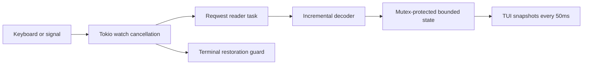

# Architecture and lifecycle

Four crates: core (decoder, bounded metrics/state, report contracts, HTTP capture), fixtures (loopback Axum), TUI (Ratatui/Crossterm), CLI (Clap and lifecycle). Core has no Axum, Clap, or Ratatui dependency. There is no database or provider integration.

The shared state is an equivalent bounded single-slot presentation model rather than a queued stream of full events. Capture updates the 256-entry ring synchronously without holding a lock across await. UI snapshot work is bounded; slow/frozen presentation never blocks network I/O beyond short bounded memory-copy locks. Evictions are counted; intermediate rendered snapshots may coalesce without losing aggregate metrics. A frozen view owns one additional bounded snapshot. Recent gaps cap at 2048 and findings at 64; all-time counters/min/max are retained. Parsing yields every 8192 bytes for cooperative cancellation. Limits bound payload previews and decoder state; the HTTP stack may transiently own its current read chunk.

A watch channel carries cancellation. Dropping the in-flight future closes the request; CLI joins capture before exit. q returns 0, Ctrl-C 130. Demo shutdown drops the server future on cancellation so a pending gap cannot delay process exit. TUI uses a Drop guard and panic hook to disable raw mode and leave alternate screen. SIGKILL/abort cannot execute Rust cleanup; `reset` restores a damaged terminal. UI errors trigger cancellation and capture join. No diagnostic logs are written inside the alternate screen; typed diagnostics appear in the footer.

Metrics use monotonic Instant. Full event bodies are not saved: preview text is filtered for control characters and capped. Raw payload may exist briefly in a bounded parser frame and dispatched event; reports serialize only explicit safe types.
